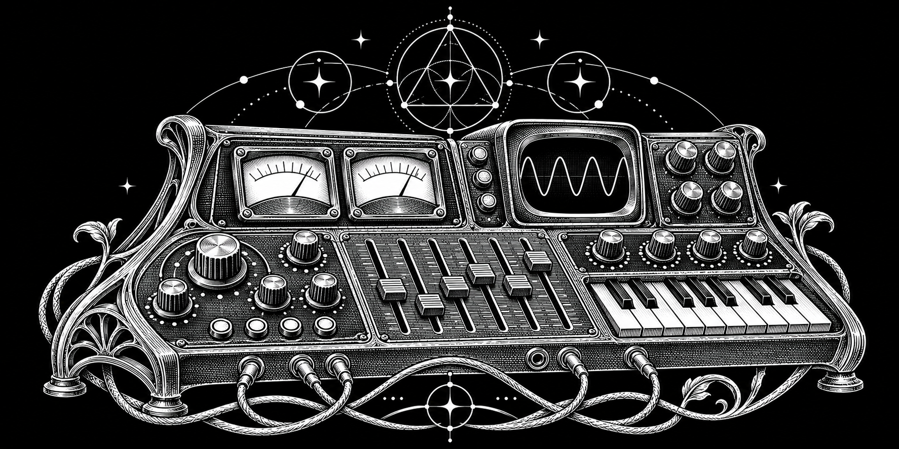

# Glyphwork

**Generic audio UI widgets: meters, knobs, faders, waveforms.**

Glyphwork is the component that provides the familiar controls and displays of an audio application, and is part of
**Signals & Sorcery**, an ecosystem of Rust audio components for building high-performance audio applications and
DAWs.

**Status: Planned: no code yet. This repository holds the design.**

## What it does

Every audio application redraws the same controls: a level meter that doesn't flicker, a knob that drags the right
way, a fader with a sensible taper, a waveform that zooms smoothly. Glyphwork is a set of these widgets, done once and
done carefully:

- **Level meters**: peak and RMS, with peak hold and clip indicators, fed by data rather than by polling.
- **Knobs and sliders**: drag, fine adjust, double-click to reset, keyboard and scroll support, with value
  formatting from the parameter's own units.
- **Faders and pan controls**: decibel tapers that match the mixer's law.
- **Waveform views**: draw precomputed peaks at any zoom level, with selection and a play head.
- **A piano roll**: notes on a grid, with selection, moving, resizing and velocity.
- **Transport displays**: bars, beats and time, from the engine's transport.

The first target is web technology (TypeScript, for browser and Electron user interfaces). A Rust-native widget set may
follow if Rust user interfaces ask for it.

## How it will be used

```tsx
// Illustrative sketch: planned, not final.
import { LevelMeter, Knob, Fader, WaveformView } from "glyphwork";

<LevelMeter source={meters.track(3)} />
<Knob param={cutoff} onChange={(v) => client.setParam(cutoff.id, v)} />
<Fader valueDb={-6} law="mixer" onChange={(db) => client.call("intent.apply", setVolume(track, db))} />
<WaveformView peaks={peaks} playhead={position} onSelect={(range) => setSelection(range)} />
```

Widgets take display data in and emit editing intentions out. A piano roll doesn't change notes itself: it says "move
these notes by one beat", and your application (or an adapter over
[Grimoire](https://github.com/shiehn/grimoire-daw-engine)'s protocol) turns that into an edit.

## Design principles

- **Data in, intentions out.** Widgets hold no engine state, so they work with Grimoire, with another engine, or with
  no engine at all.
- **Smooth at display rate.** Meters and waveforms read prepared data and draw without blocking, so a busy engine
  doesn't make the interface stutter.
- **Accessible.** Keyboard control, focus and screen reader labels are part of each widget, not an afterthought.
- **Themeable.** Colours, sizes and fonts are tokens you set.
- **No global state.** Each widget is configured by its props.
- **Headless-friendly.** Every action a widget offers maps to a protocol call, so nothing is only possible with a
  mouse.
- **Platforms.** Anywhere a modern browser engine runs: macOS, Windows, Linux and the web.

## How it fits

Glyphwork is in the "extend and display" row of Signals & Sorcery, beside
[Familiar](https://github.com/shiehn/familiar-plugin-sdk). It needs no other component to run. With the rest of
Signals & Sorcery, its meters read [Aethergate](https://github.com/shiehn/aethergate-audio-platform)'s shared-memory
meters, its waveforms draw [Scriptorium](https://github.com/shiehn/scriptorium-audio-media)'s peaks, and its edits go
through Grimoire's protocol. Familiar panels use it for their controls.

What Glyphwork deliberately doesn't do:

- **No audio.** It never processes or plays sound.
- **No application framework.** It is widgets, not a layout system or a state manager.
- **No engine logic.** It doesn't decide what an edit means; it only reports what the user did.

## The Signals & Sorcery components

Signals & Sorcery is an ecosystem of twelve Rust audio components. Each one is useful on its own, and together they
make a complete engine for audio applications and DAWs. Components meet at small published interfaces (traits, plain
data types, a wire protocol and documented file formats), never at each other's internals, so any one of them can be
replaced by another crate or by your own code.

| Component | Repository | Role | Status |
|---|---|---|---|
| Runecraft | [runecraft-audio-core](https://github.com/shiehn/runecraft-audio-core) | Shared contracts, realtime safety, process isolation and realtime-safe logging: the floor every other component stands on | In preparation |
| Orrery | [orrery-musical-time](https://github.com/shiehn/orrery-musical-time) | Tempo and meter, transports, bar, beat and sample maths, timed MIDI | In preparation |
| Summoner | [summoner-plugin-host](https://github.com/shiehn/summoner-plugin-host) | Out-of-process VST3 and Audio Unit plugin hosting with crash isolation | In preparation |
| Aethergate | [aethergate-audio-platform](https://github.com/shiehn/aethergate-audio-platform) | Audio devices (cpal, CoreAudio, a fake device for tests) and shared-memory meters | Planned |
| Leyline | [leyline-audio-graph](https://github.com/shiehn/leyline-audio-graph) | A realtime audio graph with delay compensation, and a compiler from an edit model to a graph | Planned |
| Cantrips | [cantrips-audio-dsp](https://github.com/shiehn/cantrips-audio-dsp) | Built-in mixer DSP: sampler, fader, pan, meters, compressor | Planned |
| Scriptorium | [scriptorium-audio-media](https://github.com/shiehn/scriptorium-audio-media) | Decode and encode, a sample store, streaming voices, crash-safe recording | Planned |
| Tapestry | [tapestry-session-model](https://github.com/shiehn/tapestry-session-model) | Tracks, clips, lanes and scenes; edits with undo; a crash-safe project store | Planned |
| Procession | [procession-timeline-engine](https://github.com/shiehn/procession-timeline-engine) | What plays in each block: regions, notes, automation, launches | Planned |
| Grimoire | [grimoire-daw-engine](https://github.com/shiehn/grimoire-daw-engine) | The assembled engine and its headless JSON-RPC protocol | Planned |
| Familiar | [familiar-plugin-sdk](https://github.com/shiehn/familiar-plugin-sdk) | An SDK for plugins and panels that extend a Signals & Sorcery engine | Planned |
| Glyphwork | [glyphwork-audio-ui](https://github.com/shiehn/glyphwork-audio-ui) | Audio UI widgets: meters, knobs, faders, waveforms | Planned |

Dependencies point down, never up. A component may depend on components in the rows below it, never on one above
it, and most need far less than everything below them.

```text
Extend and display   Familiar, Glyphwork
The engine           Grimoire
Musical structure    Tapestry, Procession
Signal flow          Leyline
Sound and devices    Cantrips, Scriptorium, Aethergate, Summoner
The floor            Runecraft, Orrery
```

## Licence

MIT. See [LICENSE](LICENSE).
